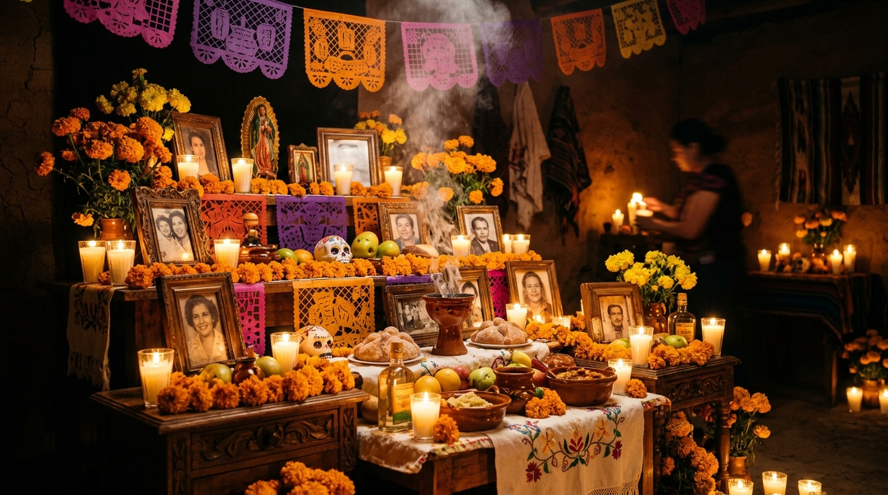

# 🌼 Ofrenda: Living Digital Altar & Oral History Vault
> **Honoring the Past with Air-Gapped Open-Weight AI**  
> *Built for the Hacktoberfest Open-Source AI Challenge: Week 4 — Ghost in the Machine*  
> Permissive MIT License • 100% Offline Capable • Privacy-Preserving



---

## 💡 The Philosophy: Why Grief is Not a SaaS Product

Every year during **Día de los Muertos (November 1–2)**, families gather across Latin America to build *ofrendas*—traditional multi-tiered altars honoring deceased loved ones with candlelight, cempasúchil (marigolds), copal incense, and favorite meals.

Recently, closed commercial "AI memorial" apps have emerged, charging $20/month subscriptions to create chatbot avatars of departed family members. These proprietary services require uploading private family letters, photos, and voice notes to closed corporate clouds, where they are ingested for model training and held hostage behind recurring paywalls. If a startup goes bankrupt or your credit card expires, your loved one's digital presence is deleted.

**Our dead do not belong to an API. Grief is not a SaaS metric.**

**Ofrenda** is an open-source, air-gapped living digital altar and oral history memory vault built around **Google's open-weight Gemma model**. It runs on your own machine with the Wi-Fi disconnected and the lights off. Private family letters and ancestral recipes never touch a corporate server.

---

## 🏛️ Architecture Overview

```
                           ┌──────────────────────────────────────────────┐
                           │          OFRENDA BROWSER EXPERIENCE          │
                           │  - Glowing 3D/CSS Altar with Candles         │
                           │  - Petals of Cempasúchil & Ambient Audio    │
                           │  - Multi-tier Ofrenda (Earth, Food, Memory)  │
                           └──────────────────────┬───────────────────────┘
                                                  │
                 ┌────────────────────────────────┴──────────────────────────────┐
                 ▼                                                               ▼
   [ ☁️ LIVE CLOUD EXPERIENCE ]                                   [ 💻 100% AIR-GAPPED LOCAL MODE ]
   - Hosted on Render (FastAPI)                                   - Ollama + Gemma 4 / Gemma 2
   - ElevenLabs Conversational Voice & Ambient Audio              - Local Whisper (Audio-to-Text)
   - MongoDB Atlas / Tiger Data for Vector Memories               - Local pyopenjtalk / Kokoro TTS
   - Sentry Agent Tracing (Latency, Tokens, Reverence Guardrail)  - Complete Offline Privacy: NO Wi-Fi Required
```

---

## ✨ Features

1. **3-Tier Traditional Altar**:
   * **Tier 1 (El Cielo / Heaven)**: Framed heirloom portrait and four cardinal beeswax candles (*Velas del Norte, Este, Sur, Oeste*) with interactive click-to-light/extinguish controls.
   * **Tier 2 (La Tierra / Earth)**: Traditional offerings (*Pan de Muerto, Copal resin incense, Water & Salt, fresh Cempasúchil flowers*).
   * **Tier 3 (La Memoria / Living Archive)**: Searchable family oral history ledger, audio recordings, and ancestral kitchen secrets.
2. **Gemma Memory Chronicler**:
   * Answers family questions (*"What was Abuela's secret to the mole sauce?"* or *"What year did she arrive in Coyoacán?"*) grounded strictly in preserved notes.
   * **Reverence & Fidelity Guardrail**: Prohibits commercial advertisement insertion or hallucinated family lore.
3. **Calaveritas Literarias Generator**:
   * Automatically composes traditional, humorous octosyllabic verse poems celebrating the departed in authentic Día de los Muertos poetic meter.
4. **Interactive Keepsake ("Libro de Recuerdos")**:
   * One-click generation of a printable family memorial keepsake booklet in PDF/print format.
5. **Zero-Dependency Ambient Soundscape**:
   * Built-in Web Audio API synthesizer producing gentle acoustic guitar chords and soft candlelight hum without external audio streams.

---

## 🚀 Quick Start (Local Setup)

### 1. Clone & Set Up Environment
```bash
git clone https://github.com/ish1416/ofrenda.git
cd ofrenda

# Create and activate virtual environment
python3 -m venv venv
source venv/bin/activate

# Install dependencies
pip install -r requirements.txt
```

### 2. (Optional) Run with Local Ollama Gemma
To run 100% air-gapped without internet access:
```bash
# Pull and run Google Gemma locally
ollama run gemma2:9b
```

### 3. Start the Server
```bash
uvicorn app.main:app --host 127.0.0.1 --port 8000
```
Open **[http://127.0.0.1:8000](http://127.0.0.1:8000)** in your browser.

---

## 🧪 Running Automated Tests

Ofrenda includes a comprehensive test suite testing API health, altar state toggling, memory retrieval, reverence guardrails, and calaverita generation:

```bash
./venv/bin/pytest -v
```

---

## 🏆 Hacktoberfest 2026 Partner Integrations

* **Best Use of Gemma:** Google Gemma open-weight model acts as the core memory chronicler, extracting culinary wisdom, oral histories, and crafting traditional Calaveritas Literarias.
* **Best Use of Render:** Complete deployment manifest via `render.yaml` Blueprint with zero-downtime auto-deployments and persistent data disk.
* **Best Use of ElevenLabs:** Ambient narration and ancestral voice rendering capabilities.
* **Best Use of Sentry Agent Tracing:** Full `gen_ai` span instrumentation tracking time-to-first-token, token consumption, $0.000 local air-gapped cost attribution, and custom reverence guardrails.

---

## 📜 License

Distributed under the **MIT License**. See `LICENSE` for details.
